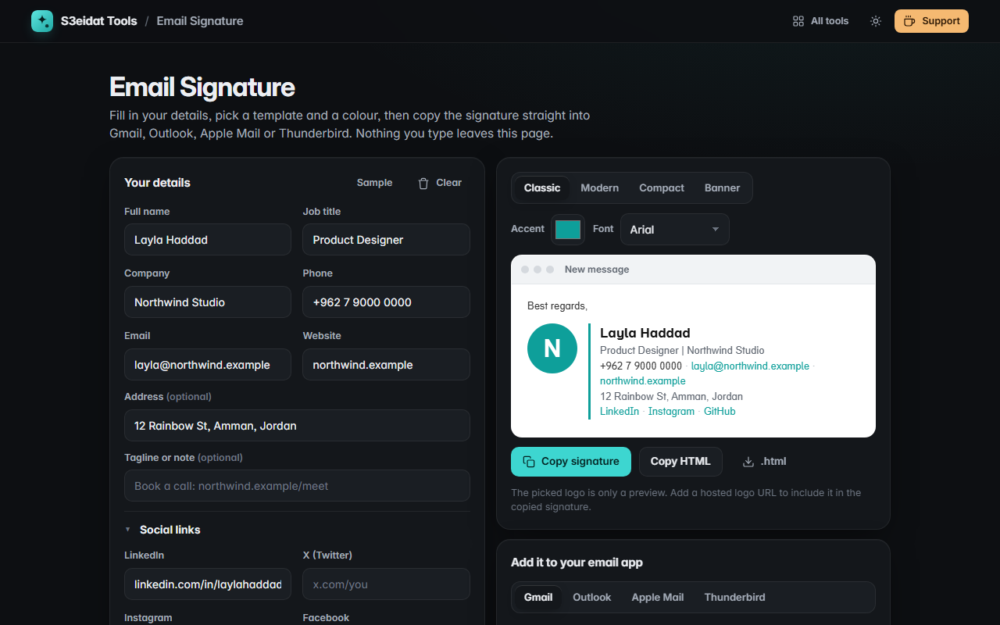

# Email Signature

> Professional HTML email signatures for Gmail, Outlook, Apple Mail and Thunderbird. Free, private, and it runs entirely in your browser.

### ▶ [Open Email Signature](https://s3eidat.github.io/email-signature/)



## Features

- Name, job title, company, phone, email, website, address, a tagline and **social links** (LinkedIn, X, Instagram, Facebook, GitHub, YouTube)
- **Four templates**: Classic, Modern, Compact and Banner, in your **accent colour** and an email-safe font
- Built with tables and inline styles, the way email apps expect
- **Copy signature** as rich content (pastes formatted into Gmail, Outlook and Apple Mail), **Copy HTML** source, or download an `.html` file
- Step-by-step **paste instructions** for Gmail, Outlook (new, web and classic), Apple Mail and Thunderbird
- **Logo**: a hosted logo URL goes only into the copied signature; pick a local file to see it in the preview
- Your details are remembered on this device

## Safety

- Everything you type is **escaped** before it is placed in the preview or in the copied HTML, so a name like `<script>` shows as text and never runs. The built-in self-test checks this for every template.
- Links are limited to `https://`, `http://`, `mailto:` and `tel:`; anything else (such as `javascript:`) is dropped.
- **The page never loads your hosted logo URL.** It is written only into the copied HTML, and the page's Content-Security-Policy would block it anyway. The preview uses the local file you pick.

## Privacy

Your details never leave your device. There is no server, no account, no analytics.
The page ships with a strict Content-Security-Policy (`connect-src 'self'`), so the browser
itself blocks any attempt to send data anywhere. Your details are kept in your browser's local storage;
**Clear** empties the form.

## Run it yourself

It's plain HTML, CSS and JavaScript with no build step:

```bash
git clone https://github.com/s3eidat/email-signature
cd email-signature
python -m http.server 8000
```

Then open http://localhost:8000.

## Support

If this saved you time, **[buy me a coffee ☕](https://s3eidat.github.io/coffee/)**. It keeps every tool free.

---

Part of **[S3eidat Tools](https://s3eidat.github.io/)**: 100+ free, private tools that run in your browser. MIT licensed.
